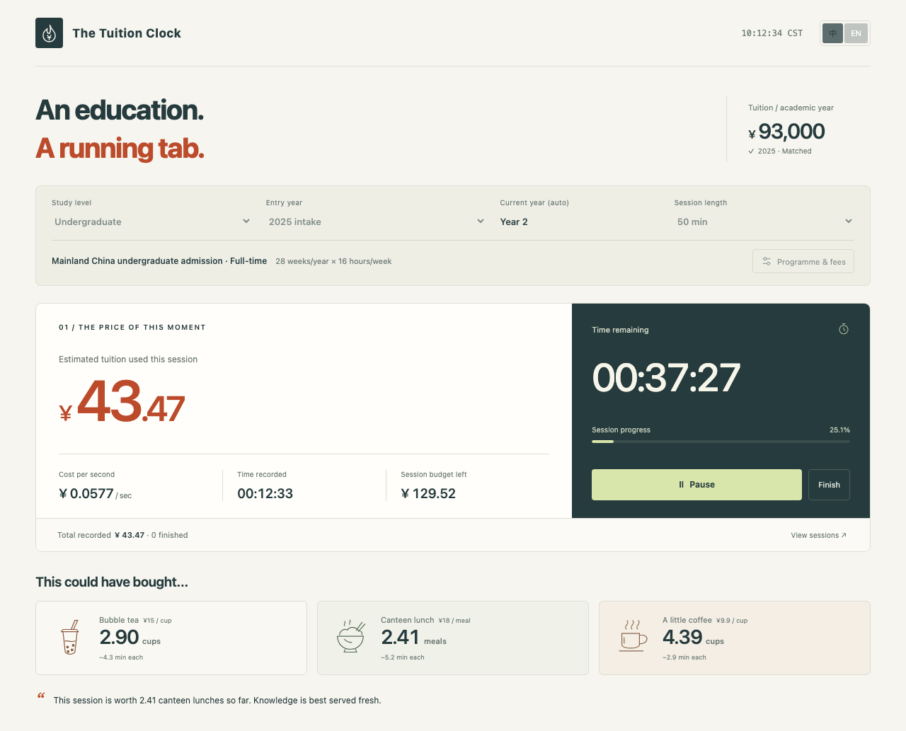

# XJTLU Tuition Clock

**西浦学费燃烧计** · English | [简体中文](README.zh-CN.md)

A small study motivator that turns tuition into a live cost-per-second counter. Choose your degree, entry year and programme, start a class timer, and see the amount in bubble teas, lunches and coffees.

[Try it online](https://xjtlu-tuition-clock.netlify.app/) · [Run locally](#run-locally) · [Fee data](docs/tuition-data.md) · [Report an issue](https://github.com/bsw2wzj9q9-collab/xjtlu-tuition-clock/issues)



## What it does

- **Matches your cohort.** Select an entry year; the study year advances each September in Shanghai time. No exact admission date needed.
- **Handles different programmes.** Undergraduate, master's and doctoral fees are matched by intake, programme and full-time or part-time study, with annual and whole-programme fees kept separate.
- **Counts through a class.** Start, pause, resume or finish a session; see elapsed time, time remaining, allocated tuition and progress. Refreshing restores the session.
- **Makes the amount familiar.** Compare it with bubble tea, a canteen lunch or coffee. Set your own prices, class length and study hours.
- **Works in Chinese and English.** Switch languages on desktop or mobile.
- **Keeps a local history.** Save up to 100 sessions in your browser and export them as CSV.

## Run locally

Requires **Node.js 22 or newer**. Building needs no package installation.

```sh
git clone https://github.com/bsw2wzj9q9-collab/xjtlu-tuition-clock.git
cd xjtlu-tuition-clock
node build.cjs
```

Open **`dist/index.html`** in a modern browser. You can copy that single file to another computer or send it to a classmate. After building, the app works offline without Node.js, a server or an account.

The generated HTML contains its own styles, scripts and fee data. It loads no third-party scripts, remote fonts or analytics. Settings and session history stay in that browser; clearing browser storage removes them. A hosted copy may have additional features or logging supplied by its hosting provider.

## Tuition matching

The bundled data was reviewed on **6 November 2026**; it is a fixed snapshot, not a live university feed.

| Study level | Automatic coverage |
| --- | --- |
| Mainland undergraduate | Every intake from 2006 to 2026 |
| Master's | 397 programme/intake records for 2015–2025, plus 55 programmes for 2026; supported study modes and durations are matched separately |
| Doctoral | Selected PhD and EdD intakes and study modes with dated evidence; subject-specific records stay separate |

If a combination has no supported fee, the app asks for your actual tuition. It does not substitute a newer cohort's price. Manual entry supports CNY, GBP and USD with a user-supplied exchange rate; displayed amounts are in CNY.

The counter estimates how tuition is spread over study time. It is an independent student project, not a university billing service. See [data coverage and calculation rules](docs/tuition-data.md) for sources, known gaps and the adjustable assumptions.

## Develop and check

Use **pnpm 11.25.0** for the browser-test dependencies. The build and core checks use only Node.js.

```sh
node build.cjs
node tests/core.cjs
node export-fees.cjs

pnpm install --frozen-lockfile
pnpm exec playwright install chromium
pnpm test:browser
```

- The fee export is **`dist/学费匹配表_含出处.csv`**, with one source URL per supported match.
- Core checks cover historical fees, study modes, programme durations, currency conversion, discounts, time allocation and the September study-year change.
- Browser checks cover both languages, five viewport widths, offline requests, timer controls, reload recovery and CSV export. Screenshots and test downloads go to `qa/`.

On Linux, use `pnpm exec playwright install --with-deps chromium` if system dependencies are missing and you can install system packages. To use an existing Chromium-compatible browser, set `PLAYWRIGHT_CHROMIUM_EXECUTABLE_PATH` to its executable.

## Project layout

| Path | Purpose |
| --- | --- |
| `src/index.html`, `src/style.css` | Interface and responsive styling |
| `src/app.js` | Language switching, settings, timer and browser storage |
| `src/data.js` | Fee matching, current snapshot records and calculation rules |
| `research/` | Historical fee records, source links and evidence gaps |
| `compile-history.cjs` | Generates `src/history.js` from reviewed records |
| `build.cjs` | Builds the standalone `dist/index.html` |
| `export-fees.cjs` | Exports supported fees and sources as CSV |
| `tests/` | Core calculation and browser checks |

Generated files in `dist/`, `src/history.js` and `qa/` are excluded from Git. To host your own copy, build it and upload the contents of `dist/` to a static host; upload only `index.html` if you do not want to serve the exported CSV.

## Contribute

Bug reports, translations and fee corrections are welcome through [issues](https://github.com/bsw2wzj9q9-collab/xjtlu-tuition-clock/issues) or pull requests. For fee corrections, include the intake year, programme, study mode, fee basis, duration where relevant, and a dated source. See the [data guide](docs/tuition-data.md#updating-records) before editing the records.

## License

Original code and documentation are available under the [MIT License](LICENSE). University names, trademarks and cited third-party materials remain the property of their respective owners. This project is not affiliated with or endorsed by XJTLU.
